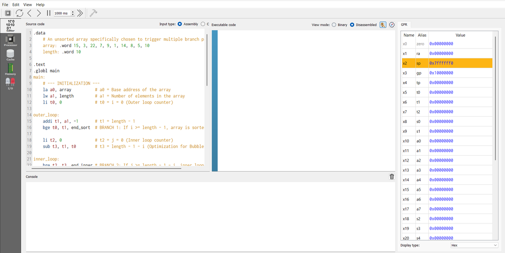
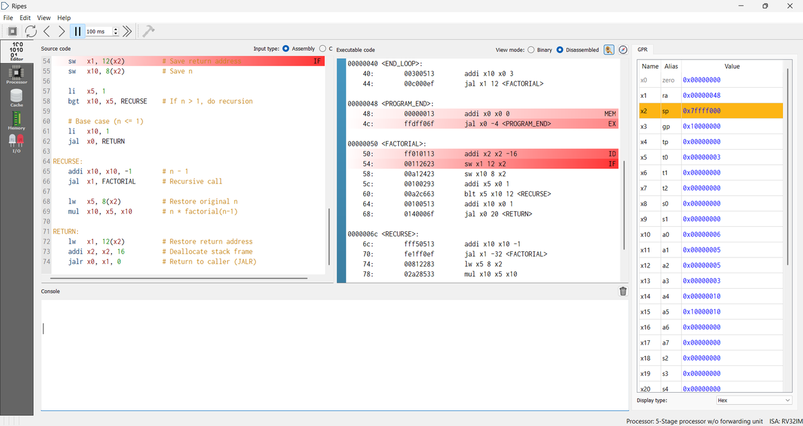
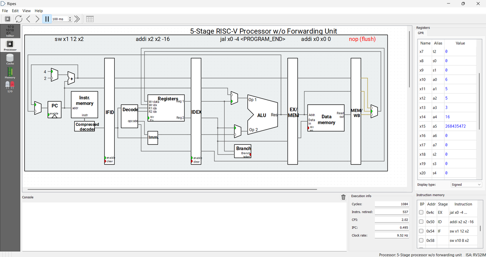
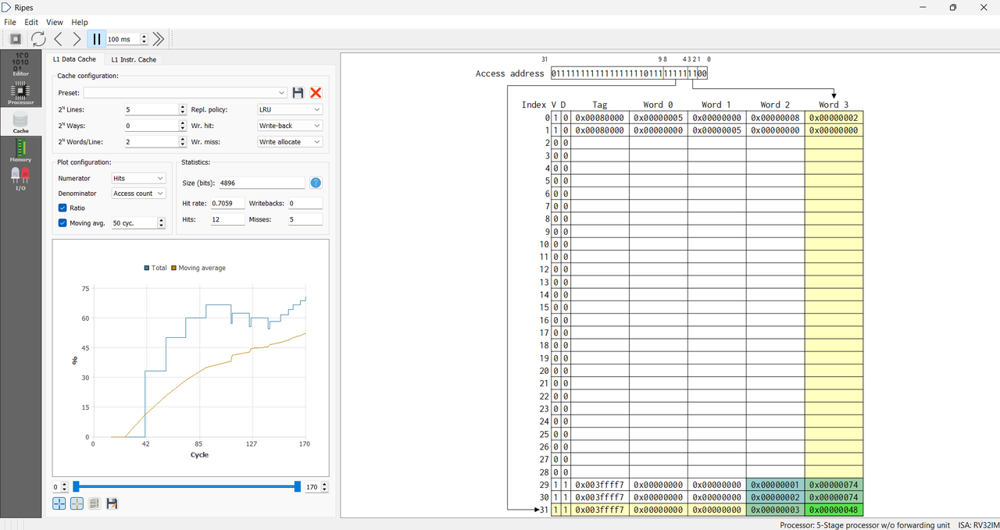
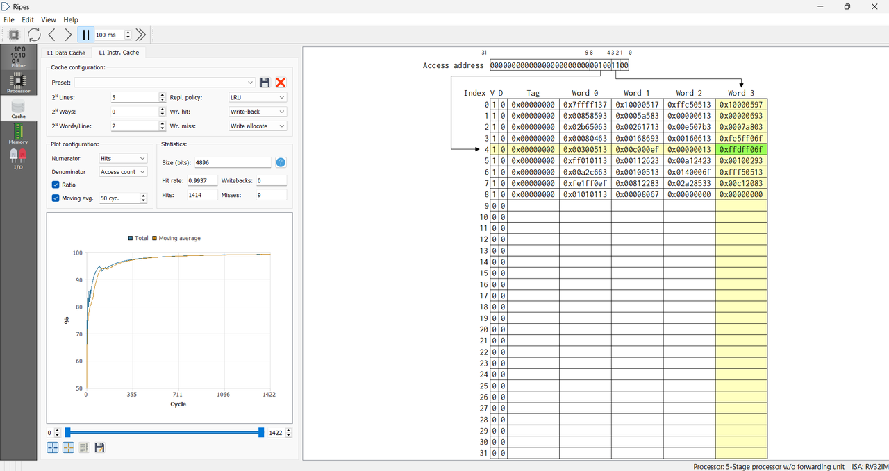
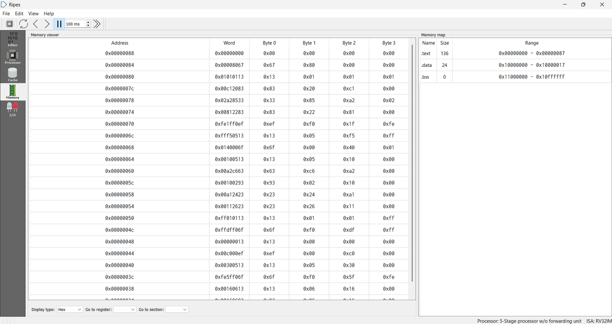

# ⚙️ Simulation of Branch-Heavy Programs (RIPES / RISC-V)

A RISC-V assembly program, run on the **[Ripes](https://github.com/mortbopet/Ripes)** visual processor simulator, that demonstrates how **branch instructions cause control hazards, pipeline flushes and stalls** in a 5-stage pipelined processor.

Course project for **PBCST404 – Computer Organization and Architecture**, B.Tech Computer Science and Engineering, **Albertian Institute of Science and Technology (AISAT), Kalamassery, Kochi**.

---

## Table of Contents

- [Overview](#overview)
- [What the program does](#what-the-program-does)
- [Screenshots](#screenshots)
- [Repository contents](#repository-contents)
- [How to run](#how-to-run)
- [What to observe](#what-to-observe)
- [Challenges](#challenges)
- [Future scope](#future-scope)
- [Team](#team)

---

## Overview

Pipelining lets a processor work on several instructions at once across the stages **IF → ID → EX → MEM → WB**. Branches break this flow: the processor keeps fetching sequential instructions before the branch condition is known, and if the branch is taken those instructions must be **flushed** and the program counter redirected.

A program with many branches and jumps is called *branch-heavy*. This project builds one and watches it execute cycle by cycle in Ripes, using the **5-stage RISC-V processor without a forwarding unit** (RV32IM).

## What the program does

The assembly program has two parts, both full of branches and jumps:

**Part A – Loop with conditional branches**
Walks through a small array and counts the non-zero elements, using `bge` (loop exit), `beq` (skip zeros) and `jal` (loop back).

**Part B – Recursive function calls**
Computes the **factorial** of a number recursively, using `jal` (call), `bgt` (recursion test) and `jalr` (return), with stack-frame handling (`sw` / `lw` on the stack pointer).

Instructions used: `addi`, `li`, `la`, `lw`, `sw`, `slli`, `add`, `mul`, `beq`, `bge`, `bgt`, `jal`, `jalr`.

A minimal example of the idea:

```asm
    addi x1, x0, 5
    addi x2, x0, 0
loop:
    beq  x1, x0, end     # branch decision happens in EX
    addi x2, x2, 1
    addi x1, x1, -1
    jal  x0, loop        # unconditional jump back
end:
```

## Screenshots

| Source editor | Executable code with stages |
|:--:|:--:|
|  |  |

| Pipeline with a flushed instruction (`nop (flush)`) | Data cache |
|:--:|:--:|
|  |  |

| Instruction cache | Memory viewer |
|:--:|:--:|
|  |  |

## Repository contents

| Path | Description |
|---|---|
| `RIPES CODE/` | The RISC-V assembly source for the project |
| `docs/screenshots/` | Images used in this README |
| `iconengines/`, `imageformats/`, `platforms/`, `styles/`, `*.dll` | Qt runtime files that ship with the Windows build of Ripes |

## How to run

1. Download Ripes from the [official releases page](https://github.com/mortbopet/Ripes/releases), or use the Ripes files in this repository (Windows).
2. Open Ripes and choose **File → Load program**, then select the assembly file from `RIPES CODE/`.
3. Open the **Select processor** dialog and pick **5-stage processor w/o forwarding unit** (ISA **RV32IM**).
4. Go to the **Processor** tab and run step by step (**Clock**) or at a chosen speed.
5. Watch the datapath, the **Registers** panel and **Execution info** (cycles, instructions retired, CPI, IPC).

## What to observe

- A branch reaches **EX**, where its condition is evaluated.
- Before that, the next sequential instructions have already been fetched.
- If the branch is **taken**, the wrongly fetched instructions are removed (shown as `nop (flush)`) and the PC jumps to the target.
- The extra cycles this wastes show up as a higher **CPI** (and lower **IPC**) for branch-heavy code.
- The data and instruction **cache** tabs show the hit rate and accesses made by the loop and the recursive calls.

## Challenges

- Pinpointing the cycle in which a branch decision is made, since pipeline stages overlap.
- Seeing and interpreting instruction flushing in Ripes.
- Debugging branch-heavy code needed careful step-by-step execution.

## Future scope

- Add and compare **branch prediction** (static and dynamic) to reduce stalls.
- Compare branch-heavy and non-branch-heavy programs to quantify the performance impact.

## Team

| Name | Roll No. |
|---|---|
| Chriz Ben Biju | AIK24CS043 |
| Ken Joe Augustine | AIK24CS074 |
| Afin T Sony | AIK24CS013 |
| Abin Binoy | AIK24CS007 |

**Department:** Computer Science and Engineering, AISAT, Kalamassery, Kochi – 682022 (2024–2028 batch)
**Faculty in charge:** Anna Isabel John
**Course:** PBCST404 Computer Organization and Architecture — project evaluation held on 31 March 2026

## References

1. Ripes simulator documentation — https://github.com/mortbopet/Ripes
2. The RISC-V Instruction Set Manual
3. *Computer Organization and Architecture* (course text)
4. Lecture notes on pipeline hazards

> Ripes is a third-party open-source project by its own authors; this repository only contains our assembly program and report material.
